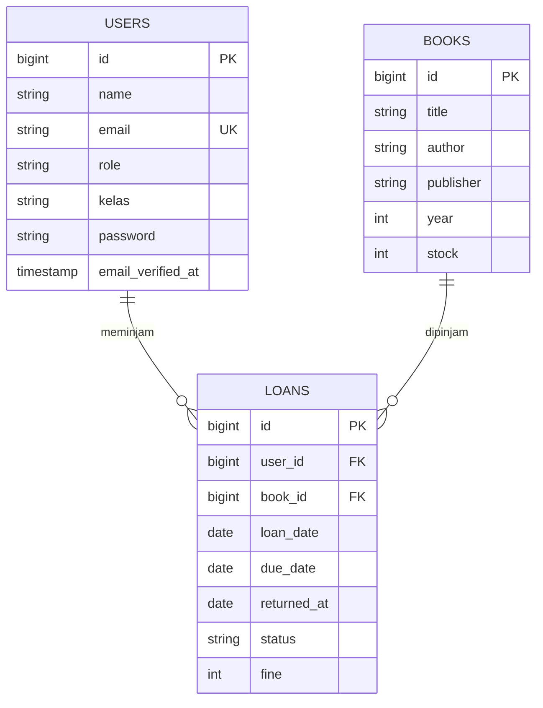

# Aplikasi Peminjaman Buku

Aplikasi web berbasis Laravel untuk mengelola data buku dan transaksi peminjaman buku di perpustakaan sekolah.

## Deskripsi Program

Aplikasi ini digunakan untuk mencatat dan mengelola data buku, pengguna, serta transaksi peminjaman buku. Sistem memiliki dua jenis pengguna yang dibedakan berdasarkan kolom `role` pada tabel `users`:

- **Admin**: Mengelola data buku dan transaksi peminjaman.
- **Siswa**: Pengguna yang dapat meminjam buku. Memiliki data tambahan berupa `kelas`.

### Alur Peminjaman

1. Siswa melakukan peminjaman buku. Sistem membuat data pada tabel `loans` dengan informasi `loan_date`, `due_date`, dan status awal `dipinjam`.
2. Ketika buku dikembalikan, sistem mengisi `returned_at` dengan tanggal pengembalian dan memperbarui status peminjaman.
3. Jika buku dikembalikan melewati batas waktu (`due_date`), denda dicatat pada kolom `fine`.

**Status pengerjaan:** Struktur database melalui migration dan model sudah dibuat. Route saat ini baru mencakup halaman awal, sedangkan controller untuk pengelolaan buku dan peminjaman belum dibuat.

## Fitur

- **Books**: Mengelola data buku yang meliputi judul, penulis, penerbit, tahun terbit, dan stok.
- **Loans**: Menyimpan data transaksi peminjaman yang meliputi tanggal pinjam, batas pengembalian, tanggal kembali, status, dan denda.
- **Users**: Mengelola data pengguna berdasarkan peran admin dan siswa, termasuk informasi kelas.

## Teknologi

- PHP
- Laravel
- MySQL
- XAMPP
- Composer

## ERD (Entity Relationship Diagram)

## Dokumentasi Fungsi / Prosedur

### 1. Model `Book` (`app/Models/Book.php`)

| Elemen | Jenis | Keterangan |
|--------|-------|------------|
| `$fillable` | Properti | Menentukan kolom yang dapat diisi secara massal, yaitu `title`, `author`, `publisher`, `year`, dan `stock`. |

### 2. Model `Loan` (`app/Models/Loan.php`)

| Elemen | Jenis | Parameter | Return | Keterangan |
|--------|-------|-----------|--------|------------|
| `$fillable` | Properti | - | - | Menentukan kolom yang dapat diisi secara massal, yaitu `user_id`, `book_id`, `loan_date`, `due_date`, `returned_at`, `status`, dan `fine`. |
| `$casts` | Properti | - | - | Mengubah atribut `loan_date`, `due_date`, dan `returned_at` menjadi objek tanggal (Carbon). |
| `user()` | Fungsi relasi | - | `BelongsTo` | Menghubungkan data peminjaman dengan pengguna melalui `user_id`. Contoh: `$loan->user->name`. |
| `book()` | Fungsi relasi | - | `BelongsTo` | Menghubungkan data peminjaman dengan buku melalui `book_id`. Contoh: `$loan->book->title`. |

### 3. Model `User` (`app/Models/User.php`)

| Elemen | Jenis | Parameter | Return | Keterangan |
|--------|-------|-----------|--------|------------|
| `$fillable` | Properti | - | - | Menentukan kolom yang dapat diisi secara massal, yaitu `name`, `email`, `password`, `role`, dan `kelas`. |
| `$hidden` | Properti | - | - | Menyembunyikan atribut `password` dan `remember_token` ketika data diubah menjadi array atau JSON. |
| `casts()` | Fungsi | - | `array` | Mengatur konversi `email_verified_at` menjadi datetime dan memastikan password di-hash secara otomatis. |
| `isAdmin()` | Fungsi | - | `bool` | Memeriksa apakah pengguna memiliki role `admin`. Mengembalikan `true` jika pengguna adalah admin dan `false` jika bukan. |

### 4. Route (`routes/web.php`)

| Method | URL | Proses | Output |
|--------|-----|--------|--------|
| GET | `/` | Menjalankan closure pada route. | Menampilkan halaman awal melalui view `welcome`. |

## Debugging

### Temuan pada Kode Saat Ini

| No | Masalah | Dampak | Perbaikan |
|----|---------|--------|-----------|
| 1 | Model `Book` dan `User` belum memiliki relasi ke `Loan`. | Data riwayat peminjaman tidak dapat diakses melalui relasi model. | Tambahkan relasi `hasMany()` pada model `Book` dan `User`. |
| 2 | Controller dan route untuk buku dan peminjaman belum dibuat. | Fitur pengelolaan buku dan transaksi peminjaman belum dapat diakses melalui browser. | Buat `BookController` dan `LoanController`, kemudian daftarkan route pada `routes/web.php`. |
| 3 | Stok buku belum terhubung dengan proses peminjaman dan pengembalian. | Stok buku berisiko tidak sesuai atau menjadi minus. | Gunakan `DB::transaction()` untuk mengurangi stok saat peminjaman dan menambah stok saat pengembalian. |

### Error Umum dan Solusinya

| Error | Penyebab | Solusi |
|-------|----------|--------|
| `Base table or view not found` | Tabel belum dibuat atau urutan migration tidak sesuai. | Periksa urutan migration dan jalankan `php artisan migrate`. |
| `MassAssignmentException` | Kolom belum terdaftar pada `$fillable`. | Tambahkan kolom yang diperlukan pada model. |
| `Call to undefined relationship` | Relasi antar-model belum didefinisikan. | Tambahkan fungsi relasi seperti `hasMany()` atau `belongsTo()`. |

### Cara Melacak Bug

- **Memeriksa nilai variabel:** Gunakan `dd($loan);` atau `dump($request->all());` untuk melihat isi data.
- **Mencatat aktivitas:** Gunakan `Log::info('data pinjam', $data);`, kemudian periksa file `storage/logs/laravel.log`.
- **Memeriksa route:** Jalankan `php artisan route:list` untuk melihat daftar route yang tersedia.
- **Memeriksa migration:** Jalankan `php artisan migrate:status` untuk mengetahui status migration.
- **Menguji model:** Gunakan `php artisan tinker` untuk menjalankan pengujian model secara langsung.
- **Menampilkan detail error:** Aktifkan `APP_DEBUG=true` pada file `.env` selama proses pengembangan.

